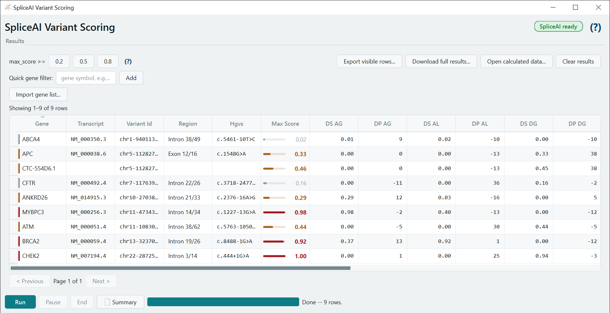

# SpliceAI for Windows

**SpliceAI Variant Scoring** is a Windows desktop program that runs
[SpliceAI](https://github.com/Illumina/SpliceAI), Illumina's deep-learning
model for predicting a variant's effect on RNA splicing, without Linux, WSL,
Python or the command line. Install it, drop in a VCF, press Run.

> Unofficial. Not affiliated with or endorsed by Illumina, Inc. For academic
> and non-commercial research use only (SpliceAI's own license terms). Not a
> diagnostic tool.



## What it does

- **One installer, nothing else to set up.** Setup installs the program per
  user (no administrator rights) with SnpEff, a private Java runtime and the
  MANE Select transcript list included. SpliceAI itself is downloaded from
  Illumina's official package during Setup (it may not be redistributed).
- **Drag and drop a VCF** onto the window, or use *Load file...*.
- **Genome build picked automatically** (hg19 / hg38) from the VCF header,
  with a clear stop if the VCF and the reference genome don't match.
- **Readable results.** Every SpliceAI score and position (DS/DP for acceptor
  and donor gain and loss), the max score drawn as a bar coloured at SpliceAI's
  own 0.2 / 0.5 / 0.8 cutoffs, and filters for those cutoffs and for gene lists.
- **Score only the genes you need.** *Genes to score* takes a pasted gene list
  (a panel, an HPO phenotype list; lists can be saved by name) and scores only
  the variants inside those genes, so a whole genome takes minutes instead of
  hours. CLI: `--genes BRCA1,BRCA2` or `--genes genes.txt`.
- **Zygosity** from the VCF's genotype (first sample), next to the gene: Het,
  Hom or Hemi, with an icon of the two copies.
- **Transcript context** from SnpEff, preferring MANE Select: transcript,
  HGVS c. notation and where the variant sits (e.g. *Intron 21/33*).
- **Illumina's precomputed scores** can be used instead of live scoring, if you
  have downloaded them.
- **Long runs are manageable:** Pause / Resume / End, CPU usage and elapsed
  time, and results exported to CSV or TSV.
- **Works on hospital networks** that inspect HTTPS (certificates are checked
  by Windows), and on Turkish-locale Windows.
- **English or Turkish:** the window, its help and notices, and Setup (the
  language box at the top right; it takes effect at the next start). Result
  files stay in English.
- **Command line** too: `SpliceAI-VariantScoring.exe --cli input.vcf --build hg38 --mode masked --fasta hg38.fa -o out.tsv`

## Download and install

1. Download `SpliceAI-VariantScoring-Setup-1.2.0.exe` from the
   [latest release](https://github.com/mmert-aydin/SpliceAI-for-Windows/releases/latest).
2. Run it. The installer isn't digitally signed, so Windows may say
   *"Windows protected your PC"*: click **More info**, then **Run anyway**.
3. Setup needs an internet connection once, for about a minute, to download
   SpliceAI (16 MB). Offline, it still finishes and the program offers the
   download later.
4. **Reference genome.** The program needs the hg19 and/or hg38 FASTA (about
   3 GB each). Click *Advanced settings... → Download...* in the program, or
   point it at files you already have (UCSC `hg19.fa` / `hg38.fa` with their
   `.fai` index). If Setup is run from a drive with a `reference-data` folder
   next to it, it copies the genomes for you and the program finds them.

**Can't download from GitHub?** Email
[aydinn.mmert@gmail.com](mailto:aydinn.mmert@gmail.com) and I'll send you the
installer.

**Requirements:** 64-bit Windows 10 or 11; about 2.6 GB of disk for the
program plus about 3 GB per reference genome; a CPU from about 2011 or later
(TensorFlow needs AVX). No Python, Java or admin rights needed.

## Try it

[`examples/clinvar-splice-demo-hg38.vcf`](examples/clinvar-splice-demo-hg38.vcf)
holds eight public ClinVar variants (hg38). Running it (masked mode) gives:

| Gene | Variant | ClinVar | SpliceAI max score |
|---|---|---|---|
| CHEK2 | c.444+1G>A | Pathogenic/Likely pathogenic | 1.00 |
| MYBPC3 | c.1227-13G>A | Pathogenic/Likely pathogenic | 0.98 |
| BRCA2 | c.8488-1G>A | Pathogenic | 0.92 |
| ATM | c.5763-1050A>G (deep intronic) | Pathogenic | 0.44 |
| APC | c.1548G>A (p.Lys516=) | Pathogenic/Likely pathogenic | 0.33 |
| ANKRD26 | c.2376-16A>G | Benign/Likely benign | 0.29 |
| CFTR | c.3718-2477C>T (deep intronic) | Pathogenic | 0.16 |
| ABCA4 | c.5461-10T>C | Pathogenic | 0.02 |

SpliceAI is a prediction. It misses some known splice variants and flags some
benign ones, which is why its scores are a research aid and not a diagnosis.

## Sequence to cDNA (in development)

The second tab predicts how a sample's sequence of one gene may be spliced,
and the cDNA and protein that follow.
Choose the genome build and the gene (SpliceAI's or RefSeq's symbol; or enter
coordinates and let the tab suggest the gene there), paste the sample's
sequence (raw or FASTA, ideally the whole gene; parts it doesn't cover come
from the reference) and click **Check compatibility**. It
aligns the sequence to the reference and lists every difference:
substitutions, insertions, deletions, duplications, inversions and complex
changes, left-aligned. Only the ones ticked under *Apply* build the sample's
sequence: by default those of 10 bp or more, and every inversion and
duplication. **Run** then predicts the sample's sequence near those changes
and builds transcripts from SpliceAI's per-base probabilities.

The **Coordinates** field takes a range (the alignment is limited to it) or a
single position (the sequence is looked for around it, then in the whole
gene, and the range found is filled in). Instead of pasting, the **From
coordinates** tab takes the events themselves, one per line, 1-based and
inclusive (`deletion chr17:17228330-17228462`, `tandem duplication ...`,
`inversion ...`, `insertion chr17:17228330 ACGT`, or HGVS g. such as
`NC_000017.11:g.17228330_17228462del`). **Generate sequence** builds the
sample's sequence from the reference and puts the events straight into the
differences table, after checking them against the reference; **Save as
FASTA...** keeps the sequence. Breakpoints from short-read CNV and SV calls
are often imprecise, and SpliceAI needs base-exact ones: **Breakpoint
sensitivity** (after Run) moves each breakpoint by 10 and 50 bases either way
and says whether the top transcript changes.

**Reading the results.** Three kinds of transcript are shown:

- **Reference**: the canonical transcript as annotated (MANE Select). For 5
  hg19 genes whose MANE Select transcript the hg19 table lacks, the NM_ at
  that locus stands in, and the tab says which; for genes with no NM_ at
  all, nothing can be predicted.
- **WT predicted**: the same method applied to the reference sequence.
- **Sample**: the method applied to the sample's sequence, up to 5
  candidates.

Only the transcript start, the transcript end and the ATG come from the
annotation; everything in between is predicted. "Change vs Reference" and
"Change vs WT predicted" compare exon by exon (identical, shifted by n
nucleotides, skipped, extra) and give approximate HGVS-style `r.` and `p.`
descriptions; frame, premature stop and NMD (50-55 nt rule) are shown too. The
relative score ranks the transcripts shown; it isn't how often each is made.
When all of them carry the same change, they differ only elsewhere in the
gene: the relative score then reflects those other sites, not how certain the
change is. Below the table, the gap between the sample's rank 1 and rank 2
shows how clearly the top candidate leads.

"Evidence vs WT" gives, for each sample candidate, the largest change in
SpliceAI's probability at the splice sites where it differs from the WT
prediction. A candidate whose differing sites all changed by less than 0.5 is
marked "weak evidence (delta < 0.5)" (the value is a setting, under Advanced;
Jaganathan et al. 2019 used cut-offs of 0.2, 0.5 and 0.8). The label never
changes the ranking. SpliceAI can also miss some documented deep intronic
variants (e.g. CFTR c.3718-2477C>T), so the absence of a predicted event does
not exclude an effect.
When the WT prediction matches the reference, that increases confidence in
the sample's prediction for that gene, but doesn't prove it. The gene line
shows the gene's WT concordance from a genome-wide run (e.g. "26/27 exons"), and the results say
whether the WT prediction is right for the exons around each change: a sample
change is more credible when the WT is correct right around it, the delta is
strong and rank 1 clearly leads rank 2. The optional **Sequence-specificity
control** repeats the prediction with random stand-ins for each change (the
same length and dinucleotide composition, or a deletion of the same size
elsewhere in the intron) and shows how often they change the transcript too:
an empirical comparison, not a p-value.

**What it doesn't do.** SpliceAI doesn't model tissue specificity,
transcription start or polyadenylation choice, regulatory factors or isoform
usage. Mid-size insertions, inversions and duplications are outside its
typical use, and are flagged as exploratory. These are predictions for
research: the predicted cDNA may differ from the real one, and RNA (cDNA)
confirmation is required for any clinical conclusion.

**Saving.** You can save results in three ways:

- **Export CSV**: the table as shown.
- **Download results**: one `.spliceai-cdna` file with every table, the
  sequences, the per-base scores and a checksummed manifest. **Open calculated
  results...** (or dragging the file onto the tab) opens it again, without
  SpliceAI, the FASTA or the database.
- **Export bedGraph**: reference, sample and delta tracks for IGV, as bgzip
  files with a tabix index.

Exported files carry a one-line research-use note (the CSV under its header
hint, the bundle's manifest, a footer under PNG and SVG images), since they
travel without the startup notice.

**The introduction and notices.** The first time the tab is opened, an
introduction explains what it does, every parameter (its default, and what
raising or lowering it does), every result term, what is always true
(research use, RNA confirmation, the model's typical use, short-read
breakpoints, deep intronic variants SpliceAI misses) and how to read the
result. It can be opened again from the "?" at the top of the tab, and its
texts are the tab's help texts. Notices about your input are classed: a "?"
lists cautions (for example a sequence that doesn't cover the whole gene),
and a red "!" marks a critical problem (a sequence that doesn't align,
overlapping changes, a change touching the ATG or the transcript's start or
end). Only critical problems stop Run, and the ATG / transcript-end case
only until "Run anyway" is ticked. In the results the same icons sit next to
the rows they concern.

**The RNA check.** For each sample candidate that differs from the WT
prediction, the "RNA check (RT-PCR)" column names the nearest exons on both
sides of the change that the reference transcript and the candidate both
keep unchanged (for example "exon 7 -> exon 9"), where RT-PCR primers could
go, and the expected product sizes for the reference and the predicted
transcript, measured in the cDNAs from the start of the first exon to the
end of the second. No primers are designed.

**The viewer** ("Open viewer", or a click on a result row) opens on the
**exon schematic**: every transcript on one axis (exons to scale, introns
compressed), in transcript orientation (5'->3', exon 1 on the left, also for
a minus-strand gene; a switch shows it in genomic orientation), with the
strand's chevrons and arrow; each applied change marked where it is, with
its type and size (a click jumps to it); what differs between the reference
and the WT prediction and between the WT prediction and each candidate; and
shading wherever the WT prediction differs from the reference, with a "!" on
a change next to such a region. The **stacked view** shows every base:
reference, sample, their scores and the delta, and the transcripts; it is
drawn in tiles in the background, so even a 2.3 Mb gene opens in under a
second and pans smoothly. Tooltips are short; a click (or Shift + hover)
puts everything about a base or exon in the panel on the right. The
**sequence comparison** aligns the reference, WT and candidate cDNAs and
proteins.

Each applied change is described once, the same way at the top of the
viewer, under the results table, in the exported CSV and in the results
file: its type and size, coordinates, where it lies in the canonical
transcript (exon, intron, 5'UTR, 3'UTR, spanning exons x to y, up- or
downstream of the transcript, with its c. range), the nearest donor and
acceptor, where inserted bases come from (a tandem or inverted copy of a
stretch, templated from another stretch of the gene, or novel), and what
sample 1 does there ("no change", "exon 14 skipped"). In the stacked view
every change is a band through all rows in its type's colour (an insertion
a line in the reference rows and the inserted bases in the sample's),
labelled above the ruler; it opens on the first change with the exons
around it. **Show origin** outlines where inserted bases come from and **Go
to origin** goes there. **Focus** (on when there are changes) keeps only the
reference, WT predicted 1 and sample 1 rows; the delta row is scaled to the
largest change in view, which it prints, and marks changes of 0.1 or more.
Exons are numbered wherever there is room. The side panel is a table in
sections whose width is kept.

**From the VCF tab.** Select a scored variant in the VCF tab's results and
click **Analyse transcript effect...** (or right-click it). A confirmation
shows the build, the gene (choose one if the variant lies in several), its
canonical transcript, the variant, its genotype from the VCF, the estimated
time, and that only this variant is applied. **Compute** fills in the
Sequence to cDNA tab (the variant as an event in "From coordinates") and
runs it. Optionally, other variants of the VCF in the same gene can be
applied too; their phase is unknown, so they go on one haplotype together.
The result's header shows the VCF tab's DS and DP next to the same scores
computed by the cDNA engine, with a "?" saying why they differ where they
do (near a gene's edge SpliceAI's VCF scoring uses N past the gene; masked
versus raw mode; other variants applied), and for a heterozygous variant
that the other allele is expected to give the WT transcript. Up to 10
selected variants can be run one after another, each saved as its own
results file; the whole VCF is never processed.

## Reference score database (in development)

The *Sequence to cDNA* tab reads SpliceAI's per-base acceptor and donor
probabilities of the reference genome from a database computed once, instead
of predicting the reference again for every analysis. Genes it doesn't have
are computed live (a minute or two each) and kept in a cache. Installed from
the USB drive, Setup copies both databases, so there is nothing to do. The
button next to "SpliceAI ready" at the top shows whether there is one per
genome build. The databases are not on GitHub: they come on the program's
USB drive (`spliceai-refdb`). Without one, the tab and that window offer two
ways to get it, side by side:

- **From a folder (USB drive)...** (or drag the folder onto the window): installs a
  database folder obtained separately (e.g. `spliceai-refdb\hg19` on the USB
  drive), after checking its build, its SpliceAI model files, and every
  file's SHA-256; the database it replaces stays until the copy is complete
  and intact.
- **Compute it on this computer...**: a guided build. It takes the build(s)
  and either all genes or a gene list (a partial build adds the validation
  set's genes so that it can be verified), checks the reference FASTA,
  SpliceAI, the gene tables and the free disk space, measures this PC's speed
  for a time estimate, and starts. All genes take many hours per build. The
  build runs in the background as a separate low-priority process, so the
  VCF tab stays usable: pause, resume or stop it, limit its CPU threads, keep
  the PC awake (default on). Closing the program stops it and it continues at
  the next start; finished genes are usable at once. When it ends, the
  database is compared with the validation set, and one that doesn't match
  isn't used.
- The cache of genes computed live (not in the database yet), with its size
  and **Clear cache**.

A database is used only if it is for the selected build, was made with the
installed SpliceAI model files, its files match the manifest's checksums
(checked in full the first time), and it hasn't failed a verification.
Databases live in `%USERPROFILE%\SpliceAI_reference_data\spliceai-refdb\<build>`.

From the command line it is built with the same exe or from source, one genome
build at a time:

```
SpliceAI-VariantScoring.exe --build-refdb --build hg38 --fasta hg38.fa --out refdb\hg38
.venv\Scripts\python -m spliceai_pipeline.refdb_build --build hg38 --fasta hg38.fa --out refdb\hg38 ^
    --refseq-dir installer\thirdparty\refseq --mane-dir installer\thirdparty\mane
```

- **Time and disk** (measured on a Ryzen 5 5600, 6 cores, no GPU): hg38
  (19,305 genes) took 9.0 hours and 1.05 GB, hg19 (20,274 genes) 9.4 hours
  and 1.08 GB.
- Stop it at any time (close it, kill it, restart the PC) and run the same
  command again: it continues after the last finished gene. While it runs it
  keeps the PC from going to sleep (the screen may still turn off);
  `--no-keep-awake` lets it sleep as usual. A Windows Update restart still
  interrupts it.
- `--chrom 21` builds one chromosome; separate processes can build different
  chromosomes into one folder at once. `--genes A,B` (or `--genes-file`)
  builds only those genes, `--threads N` leaves the rest of the CPU free.
- While a build needs room for its finished genes until their chromosome is
  packed: up to about 0.8 GB more than the final size (chromosome 1).
- From source, SpliceAI has to be importable: set `PYTHONPATH` to the folder
  it was unpacked into (`%USERPROFILE%\.spliceai_gui\python-packages`).
- **Check a finished build** (from source, about 25 minutes): it predicts a
  sample of genes again and scores a few hundred variants with SpliceAI's
  own `get_delta_scores`, compares both with the stored values, writes
  `validation-hg38.json` and the validation set into `--out`, and records the
  result in the database's manifest.

  ```
  .venv\Scripts\python -m spliceai_pipeline.refdb_validate --db refdb\hg38 --fasta hg38.fa ^
      --out refdb\validation\hg38 --refseq-dir installer\thirdparty\refseq --mane-dir installer\thirdparty\mane
  ```

**The WT validation sets** (`validation-sets/validation-set-<build>.h5`, about
2.5 MB each, in this repository) hold fresh reference predictions of 56 genes
per build, stratified by size and strand. A database built here is compared
with them before it is used.

The reference score database and the WT validation set are outputs of the
SpliceAI models (Jaganathan et al., *Cell* 2019; see [Citation](#citation)),
for non-commercial use only, under the same terms as the models.

## Build from source

Python 3.13 on Windows. Running from source, building the exe (PyInstaller)
and the installer (Inno Setup), the tests, and the full change history are in
[docs/DEVELOPMENT.md](docs/DEVELOPMENT.md).

## License

- **This program's code:** [MIT License](LICENSE).
- **SpliceAI** belongs to Illumina, Inc.: its source code is under the
  PolyForm Strict License 1.0.0 and its trained models under CC BY-NC 4.0,
  both for academic and non-commercial use only. This program never contains
  SpliceAI; each user's PC downloads it from Illumina's official package.
  Commercial use needs a license from Illumina.
- SnpEff (MIT), Eclipse Temurin (GPLv2 with Classpath Exception), MANE (NCBI,
  public), Qt/PySide6 (LGPLv3) and the other components are described in
  [LICENSE-THIRD-PARTY.md](LICENSE-THIRD-PARTY.md), which the program also
  shows on its start screen.

This software is provided without warranty of any kind. Its output must not
be used for clinical decisions without independent verification by qualified
personnel.

## Citation

If you use this program in your work, please cite SpliceAI:

> Jaganathan K, Kyriazopoulou Panagiotopoulou S, McRae JF, et al. Predicting
> Splicing from Primary Sequence with Deep Learning. *Cell*.
> 2019;176(3):535-548.e24. doi:[10.1016/j.cell.2018.12.015](https://doi.org/10.1016/j.cell.2018.12.015)

and, if you use its SnpEff annotation:

> Cingolani P, Platts A, Wang LL, et al. A program for annotating and
> predicting the effects of single nucleotide polymorphisms, SnpEff. *Fly
> (Austin)*. 2012;6(2):80-92. doi:[10.4161/fly.19695](https://doi.org/10.4161/fly.19695)

To cite this program itself, use GitHub's *Cite this repository* button
([CITATION.cff](CITATION.cff)).

## Author

**Mustafa Mert Aydın**: [aydinn.mmert@gmail.com](mailto:aydinn.mmert@gmail.com).
Bugs, questions and suggestions are welcome, here as issues or by email.

Built using Claude (Anthropic's AI coding assistant). Thanks to Illumina
for SpliceAI, Pablo Cingolani for SnpEff, NCBI and EMBL-EBI for MANE, and UCSC
for the reference genomes.

<p align="center"></p>
