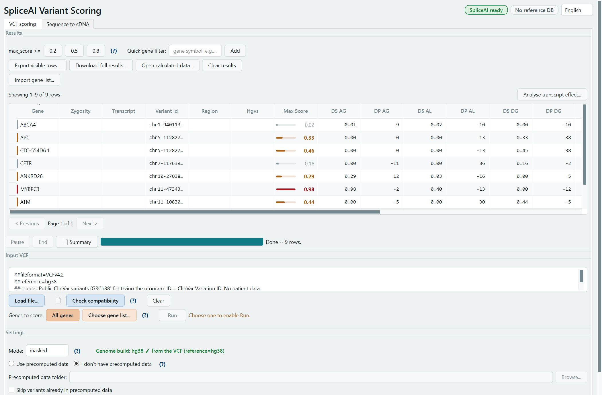
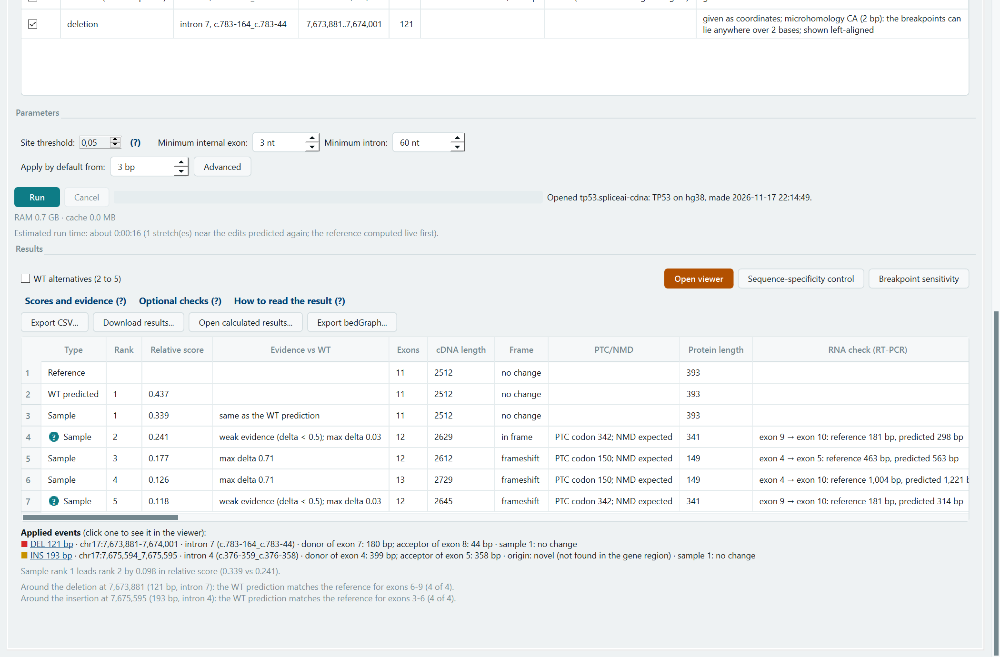
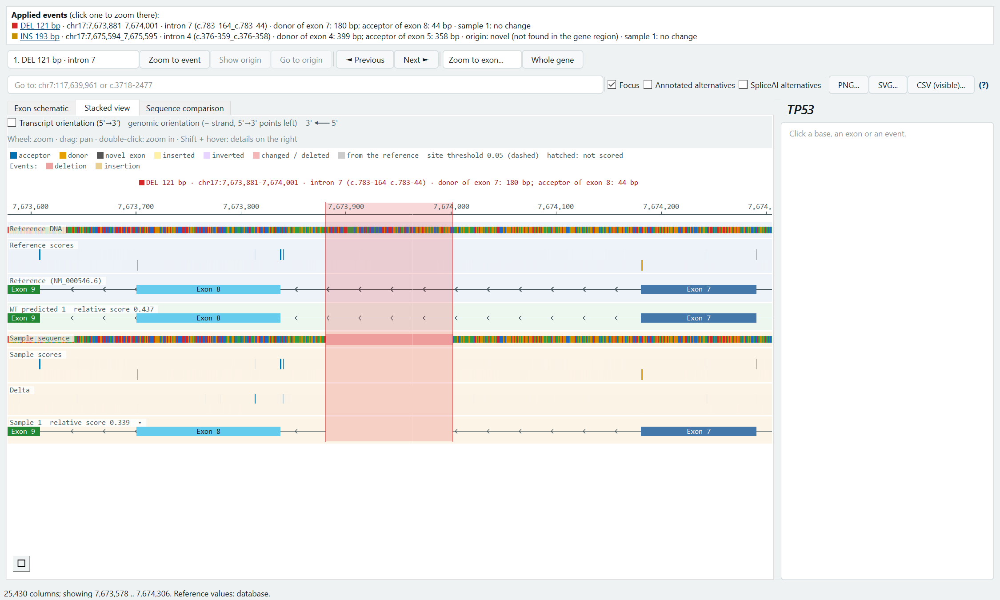
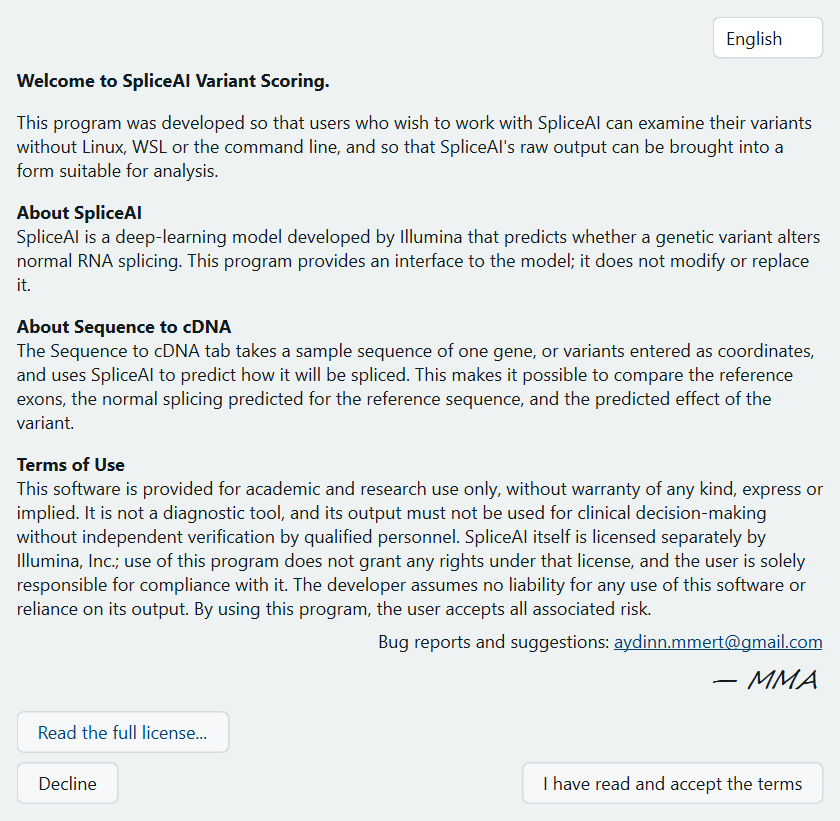

# SpliceAI for Windows

**SpliceAI Variant Scoring** is a Windows desktop application for
[SpliceAI](https://github.com/Illumina/SpliceAI), Illumina's deep-learning
model that predicts the effect of genetic variants on RNA splicing. It runs
without Linux, WSL or the command line.

> Unofficial software, not affiliated with or endorsed by Illumina, Inc. For
> academic and non-commercial research use only. Not a diagnostic tool.



## Features

- VCF scoring with SpliceAI on hg19 or hg38; the genome build is read from the VCF header.
- Scores colour-coded at the 0.2, 0.5 and 0.8 cut-offs, with filters, gene lists and zygosity.
- Transcript annotation with SnpEff and MANE Select.
- Support for Illumina's precomputed scores.
- Sequence to cDNA: predicted splicing, cDNA and protein for a gene sequence or for variants
  given as coordinates, with a transcript viewer.
- Reference score database for faster Sequence to cDNA analyses.
- English and Turkish interface.
- Command-line mode.

## Download and install

Version 1.2.0 is distributed as source code; its Windows installer will follow
with version 1.2.1. The previous installer (1.1.1) is available on the
[releases page](https://github.com/mmert-aydin/SpliceAI-for-Windows/releases)
and does not include Sequence to cDNA, the reference score database or the
Turkish interface.

To install version 1.2.0 on Windows 10 or 11 (64-bit):

1. Open PowerShell (Start menu, type `PowerShell`, press Enter) and install
   Python 3.13 and the Microsoft Visual C++ runtime:

   ```powershell
   winget install -e --id Python.Python.3.13
   winget install -e --id Microsoft.VCRedist.2015+.x64
   ```

   Approve the administrator prompt if it appears. Without winget, install
   Python 3.13 from [python.org](https://www.python.org/downloads/windows/)
   with *Add python.exe to PATH* selected, and run Microsoft's
   [vc_redist.x64.exe](https://aka.ms/vs/17/release/vc_redist.x64.exe).

2. Close PowerShell, open a new PowerShell window and paste the following
   block. The installation downloads about 1 GB and takes 5 to 15 minutes. It
   is complete when *SpliceAI for Windows is ready* is shown.

   ```powershell
   $zip = "$env:TEMP\SpliceAI-for-Windows.zip"
   Invoke-WebRequest "https://github.com/mmert-aydin/SpliceAI-for-Windows/archive/refs/tags/v1.2.0.zip" -OutFile $zip
   Expand-Archive $zip "$env:TEMP\SpliceAI-for-Windows" -Force
   Move-Item "$env:TEMP\SpliceAI-for-Windows\SpliceAI-for-Windows-1.2.0" "$env:USERPROFILE\SpliceAI"
   cd "$env:USERPROFILE\SpliceAI"
   py -3.13 -m venv .venv
   .venv\Scripts\python -m pip install -r requirements.txt
   $ok = $LASTEXITCODE -eq 0
   $s = (New-Object -ComObject WScript.Shell).CreateShortcut([Environment]::GetFolderPath("Desktop") + "\SpliceAI for Windows.lnk")
   $s.TargetPath = "$PWD\.venv\Scripts\pythonw.exe"; $s.Arguments = "-m spliceai_gui"; $s.WorkingDirectory = "$PWD"
   $s.IconLocation = "$PWD\spliceai_gui\assets\logo.ico"; $s.Save()
   if ($ok) { "SpliceAI for Windows is ready: open it from the icon on your desktop." } else { "Setup did not finish: see the red messages above, or email aydinn.mmert@gmail.com." }
   ```

   The program is installed in `C:\Users\<user>\SpliceAI`. A short folder is
   required because of the length of TensorFlow's file paths.

3. Start the program from the **SpliceAI for Windows** shortcut on the desktop.

On first start, the program downloads SpliceAI (16 MB) from Illumina's
official package, as its licence does not allow redistribution. The reference
genome (hg19 and/or hg38, about 3 GB each) is downloaded from
*Advanced settings... > Download...*, or existing FASTA files can be selected.

**Requirements:** 64-bit Windows 10 or 11, a processor with AVX support (most
processors from 2011 onwards), about 3 GB of disk space plus about 3 GB per
reference genome.

For help with the installation, contact
[aydinn.mmert@gmail.com](mailto:aydinn.mmert@gmail.com).

## Example

[`examples/clinvar-splice-demo-hg38.vcf`](examples/clinvar-splice-demo-hg38.vcf)
contains eight public ClinVar variants (hg38). In masked mode, SpliceAI gives
the following maximum scores:

| Gene | Variant | ClinVar | SpliceAI max score |
|---|---|---|---|
| CHEK2 | c.444+1G>A | Pathogenic/Likely pathogenic | 1.00 |
| MYBPC3 | c.1227-13G>A | Pathogenic/Likely pathogenic | 0.98 |
| BRCA2 | c.8488-1G>A | Pathogenic | 0.92 |
| ATM | c.5763-1050A>G (deep intronic) | Pathogenic | 0.44 |
| APC | c.1548G>A (p.Lys516=) | Pathogenic/Likely pathogenic | 0.33 |
| ANKRD26 | c.2376-16A>G | Benign/Likely benign | 0.29 |
| CFTR | c.3718-2477C>T (deep intronic) | Pathogenic | 0.16 |
| ABCA4 | c.5461-10T>C | Pathogenic | 0.02 |

SpliceAI scores are predictions and do not replace experimental confirmation.

## Sequence to cDNA

The Sequence to cDNA tab predicts how a sample's sequence of one gene is
spliced, and the resulting cDNA and protein, compared with the reference
transcript and the prediction for the reference sequence. Variants can be
pasted as a sequence, entered as coordinates, or sent from the VCF tab
(*Analyse transcript effect...*). The help buttons (?) in the program explain
each setting and result.





## Reference score database

The Sequence to cDNA tab reads the reference genome's SpliceAI scores from a
precomputed database. The database is supplied on the program's USB drive or
can be computed in the program (about 9 hours per genome build); genes not yet
in the database are computed when needed. It contains outputs of the SpliceAI
models and is subject to the same non-commercial terms.

## Build from source

Running from source for development, building the installer, the tests and
the change history are described in [docs/DEVELOPMENT.md](docs/DEVELOPMENT.md).

## License

- **This program's code:** [MIT License](LICENSE).
- **SpliceAI** belongs to Illumina, Inc.: its source code is under the
  PolyForm Strict License 1.0.0 and its trained models under CC BY-NC 4.0,
  both for academic and non-commercial use only. This program does not
  contain SpliceAI; it is downloaded from Illumina's official package on each
  computer. Commercial use requires a license from Illumina.
- Third-party components are listed in
  [LICENSE-THIRD-PARTY.md](LICENSE-THIRD-PARTY.md).

This software is provided without warranty of any kind. Its output must not
be used for clinical decisions without independent verification by qualified
personnel.

## Citation

If you use this program in your work, please cite SpliceAI:

> Jaganathan K, Kyriazopoulou Panagiotopoulou S, McRae JF, et al. Predicting
> Splicing from Primary Sequence with Deep Learning. *Cell*.
> 2019;176(3):535-548.e24. doi:[10.1016/j.cell.2018.12.015](https://doi.org/10.1016/j.cell.2018.12.015)

and, if you use its SnpEff annotation:

> Cingolani P, Platts A, Wang LL, et al. A program for annotating and
> predicting the effects of single nucleotide polymorphisms, SnpEff. *Fly
> (Austin)*. 2012;6(2):80-92. doi:[10.4161/fly.19695](https://doi.org/10.4161/fly.19695)

To cite this program, use GitHub's *Cite this repository* button
([CITATION.cff](CITATION.cff)).

## Author

**Mustafa Mert Aydın**: [aydinn.mmert@gmail.com](mailto:aydinn.mmert@gmail.com).
Bug reports, questions and suggestions are welcome as GitHub issues or by email.

Built using Claude (Anthropic's AI coding assistant). Thanks to Illumina for
SpliceAI, Pablo Cingolani for SnpEff, NCBI and EMBL-EBI for MANE, and UCSC for
the reference genomes.

<p align="center"></p>
